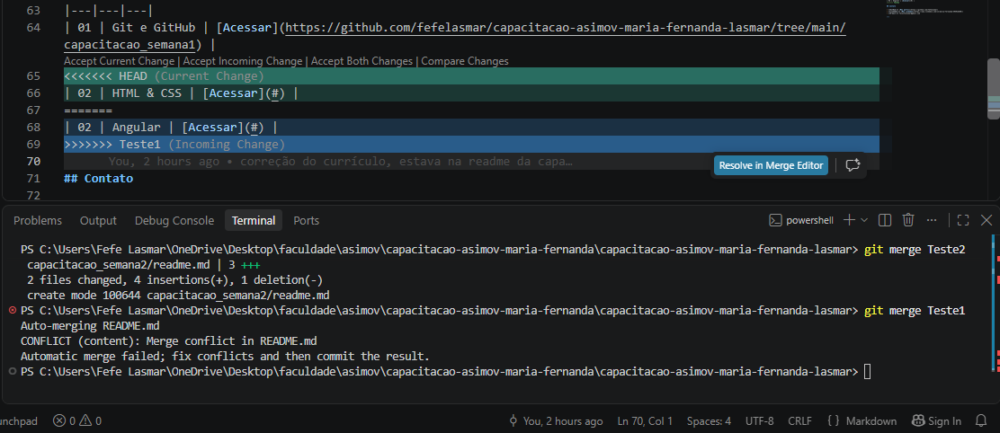

# Comandos Git e GitHub

Este documento reúne os principais comandos utilizados durante a capacitação da Asimov, com o objetivo de compreender o funcionamento do Git e do GitHub no controle de versão de projetos.

## Comandos básicos

| Comando | Função |
|---|---|
| `git init` | Inicializa um repositório Git. |
| `git clone` | Copia um repositório remoto para o computador. |
| `git status` | Mostra o estado dos arquivos. |
| `git add` | Prepara arquivos para o próximo commit. |
| `git commit` | Registra as alterações no histórico. |
| `git push` | Envia os commits para o GitHub. |
| `git pull` | Atualiza o repositório local com alterações remotas. |
| `git branch` | Lista as branches existentes. |
| `git switch` | Permite trocar de branch. |
| `git merge` | Integra alterações de outra branch. |

## Conventional Commits

O padrão Conventional Commits organiza as mensagens de commit por tipo de alteração.

Exemplos:
- `feat:` novas funcionalidades.
- `fix:` correções.
- `docs:` alterações na documentação.
- `chore:` tarefas de configuração e manutenção.

## Resolução de conflito de merge

Durante a atividade, foi provocado intencionalmente um conflito de merge entre as branches `Teste1` e `Teste2`.

O conflito aconteceu porque as duas branches modificaram a mesma linha do arquivo `README.md` principal, mas com conteúdos diferentes. Na `Teste1`, foi adicionada uma referência ao Angular, enquanto na `Teste2` foi adicionada uma referência a HTML e CSS.

Ao tentar integrar as branches, o Git identificou o conflito e não conseguiu realizar a junção automaticamente. Como indicado na foto, a seguir:

Para resolver, o arquivo foi aberto no VS Code, os marcadores de conflito foram identificados e removidos(sinais como "<,> e ="), e as duas informações foram mantidas no README (do Teste1, html e css, e do Teste 2, angular). Depois, a alteração foi adicionada e registrada com um commit. O que resultou em uma integração na main, das branchs teste1 e teste 2, ficando assim:

Depois desse erro, alterei os dados para as informações certas (mantendo apenas a semana 2 como html e css).

## Aprendizado

Durante a atividade, pratiquei os comandos básicos do Git, no ínicio digitava no automatico e esquecia de utilizar os commits convencionais, mas com a prática fui acostumando a modificalos de acordo com a norma.
Sobre o erro proposital, achei super interessante, a prática é diferente de assistir as aulas e como nunca tinha mexido com git ou github, gostei bastante.